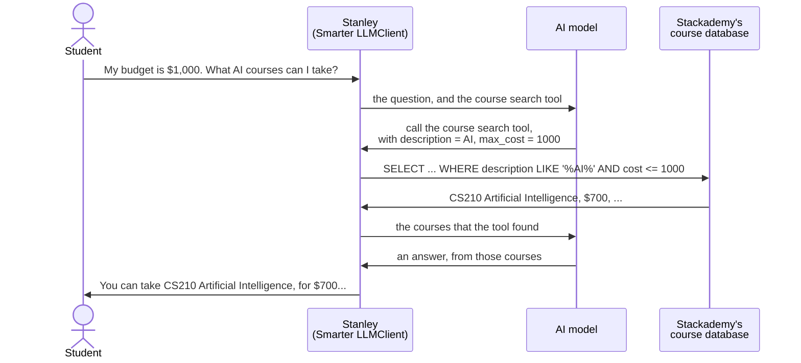
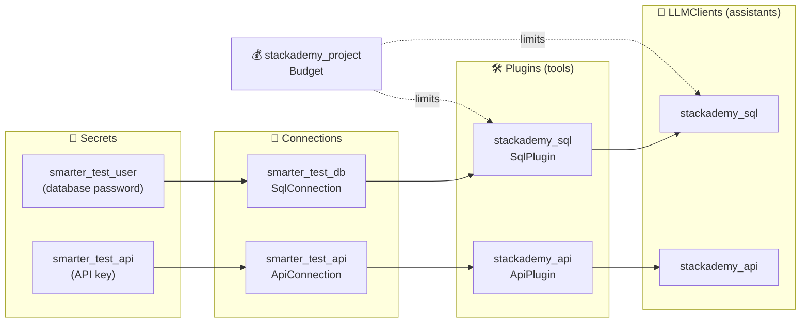

# Stackademy

[](https://github.com/smarter-sh/stackademy/actions/workflows/checks.yml)
[](https://docs.smarter.sh/en/latest/smarter-framework/smarter-manifests/stackademy.html)
[](https://smarter.sh)

**An AI course advisor for a fictional business that no AI model has ever heard of (because it doesn't exist), built with [Smarter](https://smarter.sh)'s no-code tool calling, and managed with git and GitHub.**

Ask ChatGPT, Claude or Gemini _"Does Stackademy offer a course on AI, for under $1,000?"_ and none of them can
answer. Stackademy is a fictional online code academy, so no AI model has ever seen its course catalogue. Its
catalogue lives where your organization's data lives too: **in a private database**, behind a password, where no
AI model can see it. Your products, prices, inventory, policies and customers aren't in any model's training, and
they change every day.

The way to give an AI model that data is
[**tool calling**](https://docs.smarter.sh/en/latest/smarter-resources/llmtool/how-tools-work.html): the model
asks your application to look something up, and answers from what comes back. But **connecting a private
database to an LLM's tool calls is cumbersome.** Someone has to describe each query to the model in the
format that each AI provider expects, turn the values that the model chooses into a query that can't be abused,
connect to the database securely, with credentials that the model never sees, run the query, trim the results to
fit the model, pass them back, and repeat until the model has its answer, for every provider, every model, every
database. It's a software project in its own right, and most teams that want an AI assistant over their own data
never finish it.

**Smarter's plugin architecture does all of that for you, with no code.** You describe the database, the query,
and the values that the model may fill in, in a few short text files called manifests, and Smarter does the rest.
This repository is a complete, working example: Stackademy's AI course advisor answers students' questions from
Stackademy's own private database, and from its private web API. The manifests for the advisors, their tools,
their database and API connections, their passwords and their budget are all here. Together they also show how a
prompt engineer can use git and GitHub to keep a project of many AI resources organized, reviewed and safe to
change.

You don't need to be a programmer to use this repository, and you don't need to know git yet. If you can use the
Smarter web console and a web browser, you have everything you need. This page explains the rest.

## Contents

- [Meet Stackademy](#meet-stackademy)
- [What's in this repository](#whats-in-this-repository)
- [Try the advisors in the web console](#try-the-advisors-in-the-web-console)
- [Why keep an AI project in GitHub?](#why-keep-an-ai-project-in-github)
- [Git and GitHub in ten minutes](#git-and-github-in-ten-minutes)
- [How to read a manifest](#how-to-read-a-manifest)
- [The resources, one by one](#the-resources-one-by-one)
- [Make it your own](#make-it-your-own)
- [The Smarter extension for VS Code](#the-smarter-extension-for-vs-code)
- [The automated checks](#the-automated-checks)
- [The course database](#the-course-database)
- [How Smarter loads this repository](#how-smarter-loads-this-repository)
- [Learn more](#learn-more)

---

## Meet Stackademy

Stackademy is an online code academy. It offers 48 computer science courses, from **CS101 Introduction to Computer
Science** to **CS408 Professional Practice**, on everything from web development and databases to cloud
architecture, machine learning and quantum computing. Each course has a code, a short description, a price
between $450 and $1,000, and usually a prerequisite: you take CS301 Machine Learning after CS210 Artificial
Intelligence, which you take after CS107 Algorithms.

Every day, prospective students ask the same kinds of questions:

- _"Do you offer any courses on AI?"_
- _"My budget is $1,000. What courses can I take?"_
- _"I want to study programming. Where should I start?"_

Stackademy wants an assistant on its website that answers them any time of day.

### The problem: the answers are in a private database

An AI model, however capable, knows only what was in its training data: a snapshot of the public internet.
Stackademy's catalogue was never in it. It lives in Stackademy's own database, behind a password, like most of the
data that any organization runs on. So a model asked about Stackademy's courses can do one of two things. It can
say that it doesn't know, which helps nobody. Or, worse, it can make something up: a plausible course, at a
plausible price, that doesn't exist. That's called a _hallucination_, and a student who enrolls on the strength of
one won't be pleased.

Better instructions can't fix this, because the knowledge simply isn't in the model. Pasting the whole catalogue
into the prompt doesn't work either: real catalogues are large, they change, and a prompt that's out of date is
just a slower way to be wrong. The model has to be able to **ask the database**.

### Tool calling: how a model asks the database

Modern AI models can do something better than guess: they can ask for help. This is called
[**tool calling**](https://docs.smarter.sh/en/latest/smarter-resources/llmtool/how-tools-work.html) (or function
calling). The application tells the model which tools it may use, and what each one does. When a question needs
one, the model doesn't answer. Instead, it asks the application to run the tool, and says with which values. The
application runs it, and hands the result back to the model, which answers from those facts.



### Why connecting a private database to tool calls is so hard

The diagram looks simple. Building it isn't. Every arrow in it is code that someone has to write, secure and
maintain:

- **Describing the tool to the model.** Each query must be described as a function, with typed parameters, in the
  format that the AI provider expects. OpenAI, Google, Meta and the others each expect something slightly
  different.
- **Turning the model's values into a safe query.** The model chooses the values, from whatever the user typed. Put
  them into SQL carelessly, and a user can rewrite your query (_SQL injection_) and read, or destroy, your data.
- **Reaching the database.** It's private, so it needs a network route, a driver, a pool of connections, timeouts,
  sometimes an SSH tunnel or a proxy.
- **Keeping the credentials secret.** The database password must be stored encrypted, and must never reach the
  model, the prompt, the chat or the logs.
- **Running the conversation.** Send the question and the tools, receive the tool call, run it, trim the rows so
  that they fit the model, send them back, and repeat until the model answers, for every provider and model you
  support.
- **Operating it.** Logging every call, caching repeated queries, controlling costs, and changing any of it without
  breaking the assistant that your users depend on.

It's a software project in its own right, and it's different for every database and every web API. That's why
most teams that want an AI assistant over their own data never get there.

### The solution: Smarter's plugins, with no code

This is the problem that Smarter's [**plugin architecture**](https://docs.smarter.sh/en/latest/smarter-resources/smarter-llmtool.html)
was built to solve, and it's about half of Smarter. You describe what you want, in manifests, and Smarter does every
step above:

| What you write, in a manifest                                                | What Smarter does with it                                                                                      |
| ---------------------------------------------------------------------------- | -------------------------------------------------------------------------------------------------------------- |
| A **Secret**: the database password                                          | Stores it encrypted. Nothing else ever spells it out, and the model never sees it.                             |
| A **SqlConnection**: the database's address, user, and the Secret's name     | Connects to the database securely, with a pool of connections and timeouts.                                    |
| A **SqlPlugin**: the SQL query, and its parameters described in plain words  | Describes the tool to the model, puts the model's values into the query safely, runs it, and returns the rows. |
| An **LLMClient**: the AI model, its instructions, and the plugins it may use | Runs the whole conversation with the AI provider, tool calls included, and serves the chat.                    |

The same goes for a private web API, with an **ApiConnection** and an **ApiPlugin**.

So Stackademy's course advisor, **Stanley**, never guesses. He looks the answer up, in Stackademy's own data.

Stackademy's catalogue lives in two places, as data often does in real organizations: in the registrar's
**database**, and behind the course catalogue's **web API**. These are the two most common uses of tool calling, so
this project builds Stanley twice, once for each:

| Assistant        | Looks up courses in            | With a                                                   |
| ---------------- | ------------------------------ | -------------------------------------------------------- |
| `stackademy_sql` | the course database (MariaDB)  | SqlPlugin: a SQL query, with the model's values in it    |
| `stackademy_api` | the course catalogue's web API | ApiPlugin: a web API call, with the model's values in it |

Both answer the same questions, so you can compare the two approaches side by side and copy whichever fits your
own data. Neither needed a line of code. A **budget** caps what the project may spend on AI: $2,500 a month, and
$10,000 over its six months.

### Built from many resources

Neither assistant is one thing. Each is built from several **resources**, each of which does one job, and each of
which depends on others:



- A **Secret** keeps a password or key, encrypted, so that nothing else has to spell it out.
- A **Connection** says how to reach a data source: a database's address, or an API's address, and which Secret
  holds its password.
- A **Plugin** is a tool that the AI model may call. It describes, in words the model understands, what the tool
  does and which filters it takes, and it uses a Connection to fetch the data.
- An **LLMClient** is the assistant itself: its AI model, its instructions, its personality, the tools it may use,
  and the look of its chat window.
- A **Budget** limits how much the resources it lists may spend.

Ten resources, counting a spare password, for two assistants. A real project soon has dozens, changed by several people over months. That's
where git and GitHub come in.

---

## What's in this repository

Each resource is described by a **manifest**: a small YAML text file that says what the resource should be. The
folders group the manifests by kind:

| Folder                                               | What's in it                                                                |
| ---------------------------------------------------- | --------------------------------------------------------------------------- |
| [`secrets/`](secrets/)                               | The passwords of the test database and of the course catalogue's API        |
| [`connections/sql/`](connections/sql/)               | How to reach the course database                                            |
| [`connections/api/`](connections/api/)               | How to reach the course catalogue's API                                     |
| [`plugins/sql/`](plugins/sql/)                       | The tool that searches the database, and its SQL query                      |
| [`plugins/api/`](plugins/api/)                       | The tool that searches the API                                              |
| [`llm-clients/`](llm-clients/)                       | The two Stanleys: their model, instructions, chat text and colors           |
| [`budgets/`](budgets/)                               | The project's spending limits                                               |
| [`scripts/`](scripts/)                               | Not manifests: the scripts that Smarter runs, e.g. to create the database   |
| [`Makefile`](Makefile)                               | Shortcuts for your own computer: `make database`, `make check`              |
| [`.github/`](.github/)                               | GitHub's settings for this repository: the automated checks, and Dependabot |
| [`.pre-commit-config.yaml`](.pre-commit-config.yaml) | The list of automated checks                                                |

> [!NOTE]
> The course catalogue API isn't in this repository: it comes with every Smarter platform. The course database is,
> in [`scripts/`](scripts/), and every Smarter platform creates it from there when it's set up. See
> [The course database](#the-course-database). The passwords in [`secrets/`](secrets/) are public test passwords, which is the only
> reason they can be here. Never put a real password in a repository. See [Keep secrets secret](#keep-secrets-secret).

---

## Try the advisors in the web console

Smarter platforms load this repository into their accounts when they set them up, so the two advisors may already be
in yours.

1. First, ask your usual AI chatbot, e.g. ChatGPT, Claude or Gemini: _"Stackademy is an online code academy. My
   budget is $1,000. Which of its AI courses can I take?"_ It can't know, so it will say so, or invent an answer.
2. Sign in to your Smarter web console.
3. In the sidebar, under **Harnesses**, open **LLM Clients**. Look for `stackademy_sql` and `stackademy_api`.
4. Select one, and choose **Chat** to open it in the **Prompt Engineer's Workbench**.
5. Ask Stanley the same question. He answers with real Stackademy courses, codes and prices.
6. Choose **Show the Console** to see how:
   - **Tool Calls** shows the tool call that made the difference: the tool that the model asked for, the values it
     chose (`max_cost: 1000`, `description: AI`), and the courses that came back from Stackademy's database.
   - **Architecture** draws the resources that the assistant is built from, as in the diagram above.
   - **Manifest** shows the assistant's manifest: the same text as its file in [`llm-clients/`](llm-clients/).

Now ask something unrelated, such as _"What is the capital of France?"_. Stanley's instructions tell him to stay
on topic, and he should decline.

If the advisors aren't in your account, you can add them yourself: see [Make it your own](#make-it-your-own).

---

## Why keep an AI project in GitHub?

A prompt is code. A one-word change to an assistant's instructions can change every answer it gives. Yet prompts
are often edited in place, in a web form, with no record of who changed what, or why, and no way back.

Keeping the manifests in GitHub gives an AI project the habits that software teams rely on:

- **History.** Every change is recorded: what changed, who changed it, when, and a note on why. When an assistant
  starts answering differently, you can see exactly what changed, and when.
- **Undo.** Any earlier version of any file can be brought back, even months later.
- **Review.** Changes are proposed, discussed and approved before they reach your users, like _Suggesting_ mode in
  a shared document, but for the whole project at once.
- **Safe experiments.** Try a new prompt on a copy of the project, a _branch_, without touching the version
  that's in use.
- **Automatic checks.** Every proposed change is checked for mistakes before anyone reviews it.
- **One source of truth.** The repository is the complete, current description of the project. Anyone can rebuild
  it, on any Smarter platform, from these files alone.

---

## Git and GitHub in ten minutes

**Git** is a tool that records the history of a folder of files. **GitHub** is a website that hosts those
folders, and adds a place to discuss and review changes. You can do everything on this page in your browser, on
GitHub's website.

| Term             | What it means                                                                                                                                                            |
| ---------------- | ------------------------------------------------------------------------------------------------------------------------------------------------------------------------ |
| **Repository**   | A project's folder, with its whole history. This page is the front page of the `stackademy` repository.                                                                  |
| **Commit**       | A saved change to one or more files, with a short message that explains it. The history of a repository is a list of commits.                                            |
| **Branch**       | A named line of work. `main` is the official version. A new branch starts as a copy of `main`, and your commits go to it, so `main` is untouched until you're ready.     |
| **Pull request** | A request to bring a branch's changes into `main`. It shows exactly what would change, line by line, and is where people comment, the checks run, and reviewers approve. |
| **Merge**        | Accepting a pull request: its commits join `main`.                                                                                                                       |
| **Fork**         | Your own copy of someone else's repository, on GitHub, under your account. You can change it freely.                                                                     |
| **Clone**        | A copy of a repository on your own computer. Optional: you can work entirely on GitHub's website.                                                                        |

### Look around

- Open any file, e.g. [`llm-clients/stackademy-sql.yaml`](llm-clients/stackademy-sql.yaml), to read it.
- Choose **History** on a file's page to see every change ever made to it. Choose any commit to see exactly what
  it changed: removed lines in red, added lines in green.
- Choose **Blame** to see, for each line, the last commit that changed it, and so who changed it and why.

### Change a file, the GitHub way

Here's the whole review cycle, for a small change to Stanley's welcome message:

1. Open [`llm-clients/stackademy-sql.yaml`](llm-clients/stackademy-sql.yaml) on GitHub, and choose the **pencil
   icon** (_Edit this file_). If you can't edit this repository, GitHub offers to fork it first, which is what you
   want.
2. Change the line `appWelcomeMessage: Welcome to Stackademy! How can I help you today?`.
3. Choose **Commit changes...**. Write a short message that says what and why, e.g. _"Friendlier welcome
   message"_. Select **Create a new branch for this commit and start a pull request**, and continue.
4. On the pull request's page, describe the change, and create it.
5. Watch the **Checks** at the bottom of the pull request. In about a minute they report whether your file is still
   a valid manifest. See [The automated checks](#the-automated-checks).
6. A reviewer reads the change, comments, and approves it. Then choose **Merge pull request**. Your change is now
   part of `main`.

The change is now recorded in the repository. To put it into service, apply the file to your Smarter platform: see
[Apply a manifest](#apply-a-manifest).

> [!TIP]
> GitHub's own [Hello World tutorial](https://docs.github.com/en/get-started/start-your-journey/hello-world) walks
> through the same steps in more detail, in about ten minutes.

---

## How to read a manifest

Every Smarter manifest, of every kind, has the same five sections. Here is the beginning of
[`llm-clients/stackademy-sql.yaml`](llm-clients/stackademy-sql.yaml):

```yaml
apiVersion: smarter.sh/v1
kind: LLMClient
metadata:
  name: stackademy_sql
  description: Stackademy University course catalogue inquiries using the Stackademy SQL plugin.
  version: 1.0.0
  tags:
    - stackademy
    - sql
    - llmclient
  annotations:
    - smarter.sh/llm-client/stackademy-sql/creator: QA Team
    - smarter.sh/llm-client/stackademy-sql/release-date: 2024-06-15
spec:
  config:
    prompt:
      provider: openai
      defaultModel: gpt-6-luna
      # ...
```

YAML is a plain-text format for settings. Each line is a `key: value` pair. Indentation shows what belongs to
what: `name` is part of `metadata`. A line that starts with `-` is one item of a list. A `|` or `>` at the end of a
line starts a block of text that continues on the indented lines below it. Anything after `#` is a comment, for
people only.

### `apiVersion`

The version of the Smarter manifest format that the file is written in. It's always `smarter.sh/v1` today. It lets
Smarter change the format one day without breaking the files you already have.

### `kind`

The kind of resource, e.g. `Secret`, `SqlConnection`, `SqlPlugin`, `LLMClient` or `Budget`. The kind decides what
the `spec` section may contain.

### `metadata`

What the resource is called, and what it's about. Every kind has the same metadata:

- **`name`** identifies the resource. Other manifests refer to it by this name: the `stackademy_sql` LLMClient lists
  the `stackademy_sql` plugin by name. It must be unique among your resources of the same kind, and it can't be
  changed once the resource exists. Use letters, digits and underscores.
- **`description`** says, in a sentence, what the resource is for. It's shown in the web console.
- **`version`** is your own version number for the resource, e.g. `1.0.0`, in the
  [semantic versioning](https://semver.org) style: raise the last number for a fix, the middle one for a new
  feature, the first one for a change that breaks something.
- **`tags`** are short labels that organize your resources, such as a project, a team or an environment. They
  exist to help people find things: in the web console, tags let you discover and filter the resources that belong
  together, for example everything tagged `stackademy`. Tags are labels only: they hold no values.
- **`annotations`** are key-value pairs that attach your own information to a resource. They're described below,
  because they're much more powerful than they look.

#### Annotations: Smarter's extension point

Smarter stores annotations exactly as you write them, and returns them with the resource, but it never interprets
them. That's the point: an annotation means whatever **your own software** decides it means. Annotations are how a
team connects Smarter to the rest of its systems, without changing Smarter itself.

If you know Kubernetes, the idea is the same. A Kubernetes manifest describes a resource, and its annotations carry
instructions for _other_ programs, such as an ingress controller, a certificate manager, or an operator that you
wrote for your own custom resource definitions (CRDs). Kubernetes stores the annotations. The program that watches
for them acts on them. Smarter works the same way: your program reads a resource's annotations, through the Smarter
API or through Smarter's [signals](https://docs.smarter.sh/en/latest/smarter-framework/smarter-manifests.html#integrating-with-smarter-annotations-and-signals),
and configures other platforms to match. For example:

```yaml
metadata:
  annotations:
    - stackademy.example/finance/cost-center: "4410" # your billing system charges the right department
    - stackademy.example/support/owner: admissions-team # your on-call tool knows whom to page
    - stackademy.example/monitoring/alert-channel: "#advisors" # your monitoring tool posts alerts here
    - stackademy.example/compliance/reviewed: true # your audit report lists what was reviewed
    - stackademy.example/compliance/review-date: 2026-06-15
    - stackademy.example/support/runbook: |
        If the advisor stops answering, check the course database first.
        Then contact the registrar's office.
```

Because the annotations live in the manifest, they're versioned and reviewed in GitHub along with everything else:
a change to a cost center goes through the same pull request as a change to a prompt. The rules are:

- **Keys** start with a domain that your organization controls, then a path, e.g.
  `stackademy.example/finance/cost-center`, so that your keys never collide with anyone else's. Stackademy is
  Smarter's own example, so its keys start with `smarter.sh/`. In your own projects, use your own domain.
- **Values** may be text, numbers, `true` or `false`, dates, or blocks of text.
- Anyone who can see the resource can read its annotations. Never put a password in one: that's what Secrets are
  for.

Read more in [Annotations](https://docs.smarter.sh/en/latest/smarter-framework/smarter-manifests.html#annotations),
on docs.smarter.sh.

### `spec`

The **specification**: what the resource should be. It's the heart of the manifest, and it's different for each
kind. The next section explains each kind's spec in this repository.

### `status`

What the resource actually is, right now: when it was created, whether it's deployed, and so on. Smarter writes the
status, and you never do, so none of the files in this repository has one. You'll see it when you view a resource's
manifest in the web console.

> [!TIP]
> Manifests are _declarative_: they say what the resource should be, not the steps to build it. Applying a manifest
> creates the resource if it doesn't exist, and updates it to match the file if it does. Applying the same file twice
> is harmless.

---

## The resources, one by one

### Secrets: [`secrets/`](secrets/)

```yaml
kind: Secret
metadata:
  name: smarter_test_user
spec:
  config:
    value: smarter_test_user
```

A Secret holds one sensitive value, such as a password or an API key. Smarter encrypts it, and the web console shows
only its last few characters. Other resources refer to a Secret by its **name**, never by its value, so that the
password appears in exactly one place, and changing it means changing one Secret.

- `smarter_test_user` is the password of the course database.
- `smarter_test_api` is the password of the course catalogue's API.
- `smarter_test_db_proxy_password` is a password for reaching the database through a proxy server. The connection
  in this project connects directly and doesn't use it, but it's here for a project that would.

Their `annotations` record where each password is used, for people who read the file.
[Secrets on docs.smarter.sh](https://docs.smarter.sh/en/latest/smarter-resources/smarter-secret.html)

### The database connection: [`connections/sql/`](connections/sql/)

```yaml
kind: SqlConnection
spec:
  connection:
    dbEngine: django.db.backends.mysql
    hostname: smarter-mariadb
    port: 3306
    database: smarter_test_db
    username: smarter_test_user
    password: smarter_test_user # the name of a Secret, not the password itself
    useSsl: false
    timeout: 30
    poolSize: 5
    maxOverflow: 10
```

A SqlConnection says how to reach a database: its type (`dbEngine`), address (`hostname` and `port`), which
`database`, the `username`, and which **Secret** holds the password. `timeout` is how many seconds to wait for an
answer. `poolSize` and `maxOverflow` keep a few connections open, so that each question doesn't wait to connect.
[SqlConnections on docs.smarter.sh](https://docs.smarter.sh/en/latest/smarter-resources/connection/resources/sql.html)

### The API connection: [`connections/api/`](connections/api/)

```yaml
kind: ApiConnection
spec:
  connection:
    baseUrl: ${environment_platform_scheme}://${environment_platform_domain}
    authMethod: token
    apiKey: smarter_test_api # the name of a Secret
    timeout: 30
```

An ApiConnection says how to reach a web API: its address (`baseUrl`), how to sign in (`authMethod`), and which
Secret holds the key.

This file ends in `.yaml.tpl`, because it's a **template**. The course catalogue API runs on every Smarter
platform, each at its own address, so the address can't be written into the file. The two placeholders in
`baseUrl` are filled in with the address of the platform that loads the file, e.g.
`https://platform.example.com`. If you apply this file yourself, replace `baseUrl` with your platform's address
first, and save the copy with a `.yaml` ending.
[ApiConnections](https://docs.smarter.sh/en/latest/smarter-resources/connection/resources/api.html) and
[manifest templates](https://docs.smarter.sh/en/latest/smarter-framework/smarter-manifests/manifest-templates.html)
on docs.smarter.sh

### The database tool: [`plugins/sql/`](plugins/sql/)

A SqlPlugin turns a SQL query into a tool that the AI model can call. Its spec has four parts:

- **`selector`** decides when the assistant offers the tool to the model. `directive: always` offers it with
  every question. A selector can also offer a tool only when a question contains certain `searchTerms`, which keeps
  an assistant with many tools focused.
- **`prompt`** holds the tool's own model settings: `provider`, `model`, `temperature` (how creative the model may
  be) and `maxTokens` (how long its answers may be), and a `systemRole`, the instructions to the model. Here they
  tell Stanley to rely on the tool, and to decline questions that aren't about Stackademy.
- **`connection`** names the SqlConnection to use: `smarter_test_db`.
- **`sqlData`** is the query, and its **parameters**: the filters that the model may fill in.

```yaml
sqlData:
  sqlQuery: SELECT c.course_code, c.course_name, c.description, c.cost, ...
    WHERE ((c.description LIKE CONCAT('%', {description}, '%')) OR ({description} IS NULL))
    AND (c.cost <= {max_cost} OR {max_cost} IS NULL)
  parameters:
    - name: max_cost
      type: number
      description: the maximum cost that a student is willing to pay for a course.
      required: false
    - name: description
      type: string
      description: areas of specialization for courses in the catalogue.
      enum: [AI, mobile, web, database, network, neural networks]
      required: false
  testValues:
    - name: description
      value: AI
    - name: max_cost
      value: 500
  limit: 10
```

This is prompt engineering, too. The model never sees the query. It sees the parameters' **descriptions**, and
decides from them, and from the student's question, what to fill in. _"My budget is $1,000"_ becomes
`max_cost: 1000`. The `enum` lists the only values that `description` may take, the keywords that the course
descriptions use, so the model can't invent one that matches nothing. Smarter inserts each value into the query's
`{placeholders}` as a quoted, escaped value, so that what a student types can't change the query itself. `testValues` are sample filters for trying
the tool, and `limit` caps the number of rows returned.
[SqlPlugins on docs.smarter.sh](https://docs.smarter.sh/en/latest/smarter-resources/llmtool/plugin/sql.html)

### The API tool: [`plugins/api/`](plugins/api/)

An ApiPlugin is the same idea for a web API. Its `selector`, `prompt` and `connection` work as in the SqlPlugin.
Its **`apiData`** says which `endpoint` to call, with which `method` (`GET`), which `headers`, and the same two
**parameters**, which become the API's filters, e.g. `?max_cost=1000&description=AI`.
[ApiPlugins on docs.smarter.sh](https://docs.smarter.sh/en/latest/smarter-resources/llmtool/plugin/api.html)

### The assistants: [`llm-clients/`](llm-clients/)

An LLMClient is the assistant that your users talk to. Its spec has three parts:

- **`config.prompt`** is the assistant's brain and voice:
  - `provider`, `defaultModel`, `defaultTemperature` and `defaultMaxTokens` choose the AI model and how it answers.
  - `defaultSystemRole` is the assistant's standing instructions. Stanley's tell him to use his tools whenever he
    can, and, for the SQL advisor, _"DO NOT GUESS"_.
  - `appName`, `appAssistant`, `appWelcomeMessage`, `appPlaceholder` and `appExamplePrompts` are the text of the
    chat window: its title, the assistant's name, its first message, the hint in the message box, and the example
    questions that users can click.
  - `appInfoUrl` is the page that the chat window's header links to. Both advisors link to the
    [Stackademy case study](https://smarter.sh/case-studies/stackademy), which teaches this project.
  - `deployed` says whether the assistant has its own public web address. It's `false` here: the advisors work in
    the workbench, and you decide when to publish them.
  - `allowedOrigins` lists the other web sites that may embed the assistant's chat once it's deployed. Here
    it's [smarter.sh](https://smarter.sh/case-studies/stackademy), whose case study about this project lets
    you talk to both advisors. A browser refuses a chat to any site that isn't on the list.
- **`config.styles`** are the chat window's colors, font and shapes, in Stackademy's navy and orange.
  [Styling the chat](https://docs.smarter.sh/en/latest/smarter-resources/llmclient/styles.html)
- **`plugins`** lists, by name, the tools that the assistant may use.

[LLMClients on docs.smarter.sh](https://docs.smarter.sh/en/latest/smarter-resources/smarter-llmclient.html)

### The budget: [`budgets/`](budgets/)

```yaml
kind: Budget
spec:
  config:
    unit: cost # count dollars, rather than tokens or requests
    period: month
    periodicLimit: 2500.00 # at most $2,500 in any month
    absoluteLimit: 10000.00 # and $10,000 in all
    duration: 6 # for six months, after which the budget no longer applies
    action: block # when the limit is reached, refuse further requests
    warningThreshold: 80 # warn at 80% of a limit
    message: The Stackademy project has used its budget. Please contact the project owner.
  resources:
    - kind: LLMClient
      name: stackademy_sql
    - kind: SqlPlugin
      name: stackademy_sql
```

A Budget puts a ceiling on spending, and `resources` lists what it applies to. Budgets protect a whole platform, so
only a Smarter administrator (a superuser) may apply one.
[Budgets on docs.smarter.sh](https://docs.smarter.sh/en/latest/smarter-resources/smarter-budget.html)

---

## Make it your own

The best way to learn is to build your own project from this one.

1. **Fork this repository**: choose **Fork** at the top of this page. You now have your own copy, under your GitHub
   account, which you're free to change.
2. **Rename things.** Resource names must be unique among your resources, so give your copies new names, e.g.
   `myacademy_sql`. Remember that names are references: when you rename a plugin, change its name in the LLMClient's
   `plugins` list, too.
3. **Change the prompts**, the welcome message, the example questions, the colors. Commit each change with a
   message that says why.
4. **Apply your manifests** to your Smarter platform, as below.

### Apply a manifest

The web console's **Apply Manifest** page creates a resource from a manifest file, or updates it if it exists:

1. Download the file from GitHub: open it, and choose **Download raw file**.
2. In the web console's sidebar, under **Workbench**, open **Apply Manifest**.
3. Drop the file on the **Drop Zone**, or choose **File Open**. One file at a time.
4. A message reports **Manifest Applied**, or **Manifest Apply Failed** with the reason.

**Apply the files in the order of their dependencies**, because a resource can only refer to resources that
already exist:

1. [`secrets/`](secrets/)
2. [`connections/sql/`](connections/sql/), and [`connections/api/`](connections/api/) after replacing its
   `baseUrl` (see [the API connection](#the-api-connection-connectionsapi))
3. [`plugins/sql/`](plugins/sql/) and [`plugins/api/`](plugins/api/)
4. [`llm-clients/`](llm-clients/)
5. [`budgets/`](budgets/), if you're a Smarter administrator

### Change a resource in the console, then save it to GitHub

You can also work the other way around: edit in the console, where you can test the change right away, and then
record it in GitHub.

1. Open an LLMClient in the workbench, choose **Show the Console**, then the **Manifest** tab.
2. Edit the manifest, and choose **Save**. The chat uses your change immediately: try it.
3. When you're happy, choose **Download** to save the manifest as a file.
4. Delete its `status:` section, which Smarter writes, and which doesn't belong in the repository.
5. In your repository on GitHub, open the folder, choose **Add file** → **Upload files**, and upload it in place of
   the old file. Commit it on a new branch, with a pull request, as in
   [Change a file, the GitHub way](#change-a-file-the-github-way).

The pull request now shows exactly what you changed in the console, line by line, for review.

### Publish an assistant

An assistant gets its own public web address when it's **deployed**. To deploy one from the console, set
`deployed: true` in its manifest and apply it. The workbench's **Deployment** tab then shows its address.

> [!WARNING]
> Applying a manifest that says `deployed: false` takes a deployed assistant offline. Once an assistant is live,
> change its file in GitHub to `deployed: true` too, so that the repository describes what's really running.

### Keep secrets secret

The passwords in this repository are public test passwords, and that's the only reason they're here. **Never
commit a real password, API key or other secret to a repository**, even a private one: anyone who can read it, now
or in the future, has your secret, and git's history keeps it even after you delete the file.

For your own project, keep the Secret manifests in the repository with a placeholder, e.g.
`value: set-in-the-web-console`. Then apply a private copy with the real value, from your own computer, and never
commit that copy. The automated checks look for some kinds of private keys, but they can't recognize every password.

> [!CAUTION]
> The web console hides a Secret's value. If you edit a Secret's manifest in the console, type the real value again
> before you save, or the hidden version will be saved in its place.

---

## The Smarter extension for VS Code

When you outgrow GitHub's website, [Visual Studio Code](https://code.visualstudio.com), a free code editor, is a
comfortable next step. The **Smarter Manifest** extension makes it a manifest editor:

- **It checks your manifests as you type.** Mistakes are underlined where they are, with an explanation: a
  misspelled key (_"Unknown key 'descripton'. Did you mean 'description'?"_), a missing setting, a value that isn't
  allowed. `Ctrl+.` (`Cmd+.` on a Mac) offers a fix.
- **It helps you write them.** It suggests the settings that each section may have, explains each one when you
  hover over it, and can insert a complete example manifest of any kind.
- **It works with your platform.** With an API key, it applies a manifest, deploys an assistant, or opens any of
  your resources' manifests, without leaving the editor.

To install it:

1. [Download and install VS Code](https://code.visualstudio.com/download) on your computer.
2. In VS Code, open the **Extensions** view (the four-squares icon on the left, or `Ctrl+Shift+X`, `Cmd+Shift+X`
   on a Mac).
3. Search for **Smarter Manifest**, published by Querium, and choose **Install**. Or open the
   [extension's page on the Visual Studio Marketplace](https://marketplace.visualstudio.com/items?itemName=Querium.smarter-manifest)
   and choose **Install** there.
4. To connect it to your platform, create an API key in the web console's **API Keys** page, then run
   **Smarter: Select Platform...** and **Smarter: Set API Key...** from VS Code's Command Palette (`Ctrl+Shift+P`,
   `Cmd+Shift+P` on a Mac).

VS Code also has git built in. Its **Source Control** view commits your changes, and the **Clone Git Repository**
command, with a GitHub sign-in, copies your fork to your computer, all without the command line.
[The VS Code extension on docs.smarter.sh](https://docs.smarter.sh/en/latest/smarter-framework/vs-code-extension.html)

---

## The automated checks

Every pull request, and every change to `main`, runs a set of checks, listed in
[`.pre-commit-config.yaml`](.pre-commit-config.yaml) and [`.github/workflows/checks.yml`](.github/workflows/checks.yml). GitHub shows the result on the pull request, with a ✅ or a
❌, and the details are one click away. The checks make sure that:

- every file is valid YAML, and tidy: no stray spaces at the ends of lines, one newline at the end of each file;
- the YAML follows a consistent style ([yamllint](https://yamllint.readthedocs.io));
- there are no common typos, in the prompts as much as anywhere ([codespell](https://github.com/codespell-project/codespell));
- no private key has been committed by mistake;
- the shell script that creates the course database is free of common mistakes ([ShellCheck](https://www.shellcheck.net));
- **each manifest is a valid manifest of its kind**, checked against the JSON Schema that Smarter publishes for each
  kind: every required setting is there, and every value is of the right type. A mistake here would otherwise only
  show up when someone applies the file. This is why each folder holds manifests of a single kind.
- the course database loads, and its test users can read the courses but not change them.

If a check fails, open its details, fix the file on your branch, and commit again: the checks run again.

**Dependabot**, GitHub's update robot, keeps the checks themselves up to date. Once a month it looks for new versions
of them, and opens a pull request for each one, which you review and merge like any other.

<details>
<summary>Running the checks on your own computer</summary>

The checks are [pre-commit](https://pre-commit.com) hooks. If you work in a clone of this repository, you can run
them before each commit, so that mistakes never reach GitHub. With Python installed:

```console
pip install pre-commit
pre-commit install          # run the checks before each commit
pre-commit run --all-files  # run them now, on every file
```

</details>

---

## The course database

Stanley's SQL advisor reads Stackademy's catalogue from a real database, `smarter_test_db`, whose `courses` table
holds the 48 courses. [`scripts/smarter_test_db.sql`](scripts/smarter_test_db.sql) creates it: the database, the
table, the courses, and two users, `smarter_test_user` and `smarter_test_proxy_user`, which may read the courses but
not change them. Their passwords are their names, which is why the
[SqlConnection](#the-database-connection-connectionssql) and the [Secrets](#secrets-secrets) can be public.

You don't need to do anything to get it: every Smarter platform creates it when it's set up (see
[How Smarter loads this repository](#how-smarter-loads-this-repository)). To change the catalogue, change the SQL
script, and the next platform setup recreates the database from it.

[`scripts/create-course-database.sh`](scripts/create-course-database.sh) runs the SQL script against a MariaDB or
MySQL server. Running it again replaces the database, so it's also how you reset the catalogue. It connects as a user
that may create databases and users, e.g. `root`, and reads that user's password from the `MYSQL_PWD` environment
variable, or asks for it.

```console
make database                                                           # into the smarter-mariadb container
                                                                        # of Smarter's local development environment
./scripts/create-course-database.sh --container my-mariadb              # into another Docker container
MYSQL_PWD=... ./scripts/create-course-database.sh --host db.example.com # into a server, with the mariadb client
./scripts/create-course-database.sh --help                              # every option
```

The automated checks load the script into a new MariaDB server, twice, and check that both users read 48 courses and
can't change them.

---

## How Smarter loads this repository

Smarter platforms load this repository themselves, when they're set up, so that every account starts with a working
example. They read every manifest, skip the files that aren't manifests (this README, the checks), fill in the
template, and apply the manifests in the order of their dependencies: Secrets, then Connections, then plugins, then
LLMClients, then the Budget. The folders are only for people. Any project laid out like this one can be loaded the
same way.

### Scripts

Some things can't be described by a manifest, such as the course database itself. A project keeps the scripts that
create them in its [`scripts/`](scripts/) folder, which never holds manifests, and lists them in
[`scripts/scripts.yaml`](scripts/scripts.yaml):

```yaml
scripts:
  - path: create-course-database.sh # in scripts/
    stage: pre # pre: before the manifests are applied. post: after
    description: Create the course database, smarter_test_db, ...
    timeout: 300 # seconds; optional
```

When a platform is set up, Smarter runs the `pre` scripts, applies the manifests, deploys the assistants, then runs
the `post` scripts, each in the order of `scripts.yaml`. Only the scripts listed there run, so the folder can also
hold the files they read, such as the SQL script. Each script must be executable, with a `#!` line, and runs in the
repository's folder with only these environment variables, never the platform's own passwords and keys:

| Variable                                                  | Value                                                   |
| --------------------------------------------------------- | ------------------------------------------------------- |
| `SMARTER_DATABASE_HOST`, `SMARTER_DATABASE_PORT`          | the platform's database server                          |
| `SMARTER_DATABASE_ADMIN_USERNAME`, `MYSQL_PWD`            | its administrator, and the administrator's password     |
| `SMARTER_ACCOUNT_NUMBER`, `SMARTER_USERNAME`              | the account and the user who own the project            |
| `SMARTER_REPOSITORY_URL`, `SMARTER_REPOSITORY_ROOT`       | this repository, and the folder it was downloaded into  |

Scripts run once, when the platform is set up, and not again for each new account.

---

## Learn more

On [docs.smarter.sh](https://docs.smarter.sh):

- [The Stackademy example project](https://docs.smarter.sh/en/latest/smarter-framework/smarter-manifests/stackademy.html)
- [How tool calling works](https://docs.smarter.sh/en/latest/smarter-resources/llmtool/how-tools-work.html)
- [The web console](https://docs.smarter.sh/en/latest/smarter-platform/smarter-web-console.html)
- [Manifests](https://docs.smarter.sh/en/latest/smarter-framework/smarter-manifests.html): their structure, tags and
  annotations
- [Secrets](https://docs.smarter.sh/en/latest/smarter-resources/smarter-secret.html),
  [Connections](https://docs.smarter.sh/en/latest/smarter-resources/smarter-connection.html),
  [plugins](https://docs.smarter.sh/en/latest/smarter-resources/smarter-llmtool.html),
  [LLMClients](https://docs.smarter.sh/en/latest/smarter-resources/smarter-llmclient.html) and
  [Budgets](https://docs.smarter.sh/en/latest/smarter-resources/smarter-budget.html)
- [API keys](https://docs.smarter.sh/en/latest/smarter-platform/api-keys.html)

On GitHub:

- [GitHub's getting started guide](https://docs.github.com/en/get-started/start-your-journey)
- [About pull requests](https://docs.github.com/en/pull-requests/collaborating-with-pull-requests/proposing-changes-to-your-work-with-pull-requests/about-pull-requests)
- [Smarter itself](https://github.com/smarter-sh/smarter), and the [Smarter project](https://smarter.sh)

Stackademy, its courses and its people are fictional. Smarter is community-supported open-source software.
